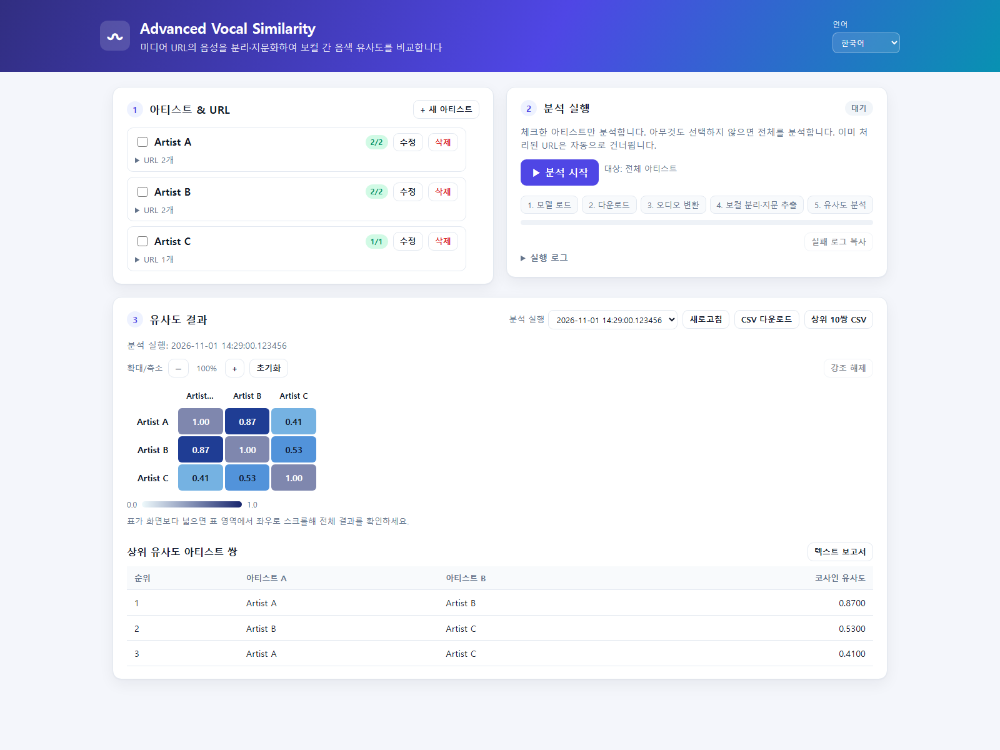

# Advanced Vocal Similarity

English | [한국어](README.md)

[](https://github.com/Devleu0/Advanced_Vocal_Similarity/actions/workflows/ci.yml)

Analyze vocal timbre similarity between artists by extracting voice fingerprints from media URLs. Add multiple URLs to an artist-specific text file; `yt-dlp` retrieves the audio, then vocal separation and speaker embedding extraction produce a similarity matrix and reports.

> **Note:** URLs must be HTTP(S) addresses from sites supported by yt-dlp. Downloads can still fail due to site support, authentication or age restrictions, regional limits, or network conditions. Only use media you are authorized to access and analyze.

## Features

- Process multiple media URLs per artist
- Separate vocals with Demucs and extract voice embeddings with SpeechBrain ECAPA-TDNN
- Generate cosine-similarity matrices, a clustermap, and TXT/CSV reports for the top 10 pairs
- Run from the CLI or web UI and revisit archived results
- Track artist/URL processing status, view logs, copy failure logs, zoom and highlight matrix rows/columns in the web UI
- Switch the web UI language between English and Korean

## Web UI preview

This documentation screenshot uses synthetic data (`Artist A`, etc.); it contains no real artist names or user URLs.



## Requirements

- Python 3.11+
- FFmpeg installed and available on `PATH`
- Node.js 22+ (used by the current download command for JavaScript challenge support)
- A working PyTorch environment. For CUDA, install a compatible build using the official PyTorch instructions.

## Installation

### Windows quick start

`run_web.bat` starts the web UI; `run.bat` starts the CLI pipeline. On first run, the scripts create a virtual environment and install dependencies.

```bat
run_web.bat
```

The web UI opens at `http://localhost:8000` by default. Use `run.bat` to run the CLI.

### Manual installation (Windows, macOS, Linux)

```bash
git clone https://github.com/Devleu0/Advanced_Vocal_Similarity.git
cd Advanced_Vocal_Similarity
python -m venv venv
```

Create the virtual environment, then activate it using the command for your operating system.

```bash
# Windows PowerShell
.\venv\Scripts\Activate.ps1
```

```bash
# macOS/Linux
source venv/bin/activate
```

Install PyTorch first, then install the project dependencies.

```bash
python -m pip install torch torchaudio
python -m pip install -r requirements.txt
python -m pip install -r requirements-web.txt  # only if you need the web UI
```

For CPU-only setups or CUDA-specific installation, first check the [PyTorch installation guide](https://pytorch.org/get-started/locally/).

## Inputs and usage

Create one `.txt` file per artist under `inputs/`. Add one media URL per line; each file can contain multiple URLs.

```text
inputs/
├── Artist A.txt
└── Artist B.txt
```

Example file contents:

```text
https://media.example.com/track/one
https://media.example.com/track/two
```

URLs are validated as external HTTP(S) addresses before being passed to yt-dlp. Passing validation does not guarantee that a site is supported; yt-dlp determines whether it can extract the media.

### CLI

```bash
python main.py
```

On Windows, you can also run `run.bat`.

### Web UI

```bash
python -m pip install -r requirements-web.txt
python web.py
```

Open `http://localhost:8000` in a browser. To allow access from another device, you can bind to all interfaces, but the web UI has no authentication; use this only on a trusted network.

```bash
python web.py --host 0.0.0.0 --port 8000
```

The language selection is saved in the browser. On the first visit, the browser language is used to choose the initial UI language.

## Results and data retention

- URL inputs are stored in `inputs/<artist name>.txt`.
- Downloaded audio, separated vocals, and embeddings are stored under `database/<artist name>/` and reused by later runs.
- Each run's matrix, clustermap, and top-10 TXT/CSV reports are archived under `database/runs/<run ID>/`.
- Result files in the `database/` root are updated to show the latest run. Archived run results remain available under `runs/`.
- In the web UI, select a run, zoom the matrix, or click an artist/cell to highlight the related rows and columns.

## Configuration

Adjust processing options in `vocal_similarity/config.py`.

| Setting | Description | Default |
| --- | --- | --- |
| `DEVICE` | Model device | `cuda:0` when CUDA is available; otherwise `cpu` |
| `SR` / `CHUNK_SEC` | Audio sample rate / fingerprint chunk length | `16000` / `5` seconds |
| `USE_VAD` | Remove silent chunks | `False` |
| `USE_OUTLIER_REMOVAL` / `EMB_TOP_K_RATIO` | Remove embedding outliers and set the retained ratio | `True` / `0.8` |
| `DOWNLOAD_AUDIO_QUALITY` | yt-dlp audio format selector | `bestaudio/best` |
| `MP3_BITRATE` | Converted audio bitrate | `192k` |
| `DEMUCS_MODEL` | Vocal separation model | `mdx_extra` |
| `CLEANUP_RAW_AUDIO` | Delete the converted source MP3 after processing | `False` |

## Development and tests

```bash
python -m pip install -r requirements.txt -r requirements-web.txt -r requirements-dev.txt
python -m pytest tests/
ruff check .
```

When the server is running, the web API documentation is available at `http://localhost:8000/docs`.

## License

[MIT License](LICENSE)

## Key open-source projects

[PyTorch](https://pytorch.org/) · [SpeechBrain](https://speechbrain.github.io/) · [Demucs](https://github.com/facebookresearch/demucs) · [yt-dlp](https://github.com/yt-dlp/yt-dlp) · [FFmpeg](https://ffmpeg.org/)
