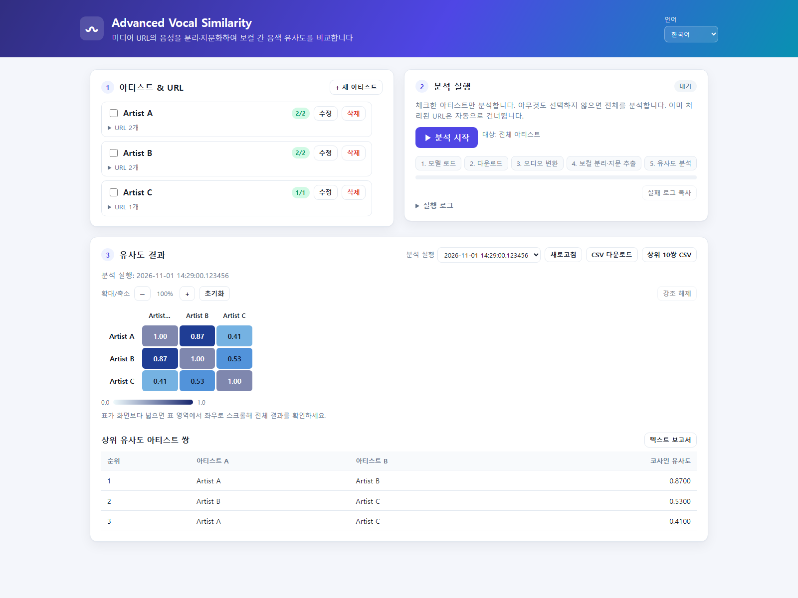

# Advanced Vocal Similarity

[English](README.en.md) | 한국어

[](https://github.com/Devleu0/Advanced_Vocal_Similarity/actions/workflows/ci.yml)

미디어 URL에서 음성을 추출해 아티스트별 음성 지문을 만들고, 아티스트 간 보컬 음색 유사도를 비교하는 도구입니다. URL을 아티스트별 텍스트 파일에 여러 줄로 등록하면 `yt-dlp`로 오디오를 가져오고, 보컬 분리와 임베딩 추출을 거쳐 유사도 행렬과 보고서를 생성합니다.

> **주의:** URL은 yt-dlp가 지원하는 사이트의 HTTP(S) 주소여야 합니다. 사이트 지원 여부, 로그인·연령 제한, 지역 제한, 네트워크 상태 등에 따라 다운로드되지 않을 수 있습니다. 본인이 접근 및 분석할 권리가 있는 미디어만 사용하세요.

## 주요 기능

- 아티스트별 여러 미디어 URL을 한 번에 등록하고 처리
- Demucs로 보컬을 분리하고 SpeechBrain ECAPA-TDNN으로 음성 임베딩 추출
- 코사인 유사도 행렬, 클러스터맵, 상위 유사도 10쌍 TXT/CSV 보고서 생성
- CLI 또는 웹 UI로 실행하고, 실행별 결과를 다시 조회
- 웹 UI에서 아티스트·URL별 진행 상태, 작업 로그, 실패 로그 복사, 행렬 확대/축소 및 강조 표시
- 웹 UI 표시 언어를 한국어 또는 영어로 선택

## 웹 UI 미리보기

아래 이미지는 문서용 합성 데이터(`Artist A` 등)로 만든 화면입니다. 실제 아티스트명이나 사용자 URL은 포함하지 않습니다.



## 요구 사항

- Python 3.11 이상
- FFmpeg 설치 및 PATH 등록
- Node.js 22 이상 (현재 다운로드 명령에서 JavaScript 챌린지 처리에 사용)
- PyTorch 실행 환경. CUDA를 사용하려면 PyTorch 공식 설치 안내에 따라 호환되는 버전을 설치하세요.

## 설치

### Windows 빠른 시작

`run_web.bat`은 웹 UI를, `run.bat`은 CLI 파이프라인을 시작합니다. 최초 실행 시 가상환경과 의존성을 설치합니다.

```bat
run_web.bat
```

웹 UI는 기본적으로 `http://localhost:8000`에서 열립니다. CLI를 실행하려면 `run.bat`을 사용하세요.

### 수동 설치 (Windows, macOS, Linux)

```bash
git clone https://github.com/Devleu0/Advanced_Vocal_Similarity.git
cd Advanced_Vocal_Similarity
python -m venv venv
```

가상환경을 만든 뒤 운영체제에 맞게 활성화합니다.

```bash
# Windows PowerShell
.\venv\Scripts\Activate.ps1
```

```bash
# macOS/Linux
source venv/bin/activate
```

그다음 PyTorch를 먼저 설치하고 프로젝트 의존성을 설치합니다.

```bash
python -m pip install torch torchaudio
python -m pip install -r requirements.txt
python -m pip install -r requirements-web.txt  # 웹 UI를 사용할 경우
```

GPU를 사용하지 않거나 CUDA 설정이 필요한 경우, 먼저 [PyTorch 설치 안내](https://pytorch.org/get-started/locally/)에서 환경에 맞는 설치 명령을 확인하세요.

## 입력 및 실행

`inputs/`에 아티스트 이름으로 `.txt` 파일을 만들고, 분석할 URL을 한 줄에 하나씩 입력합니다. 파일당 여러 URL을 등록할 수 있습니다.

```text
inputs/
├── Artist A.txt
└── Artist B.txt
```

예시 파일 내용:

```text
https://media.example.com/track/one
https://media.example.com/track/two
```

URL이 일반적인 HTTP(S) 주소인지 검증한 다음 yt-dlp에 전달합니다. 검증 통과는 사이트가 지원된다는 뜻이 아니며, 최종 지원 여부는 yt-dlp가 판단합니다.

### CLI

```bash
python main.py
```

Windows에서는 `run.bat`을 실행할 수 있습니다.

### 웹 UI

```bash
python -m pip install -r requirements-web.txt
python web.py
```

브라우저에서 `http://localhost:8000`을 엽니다. 다른 기기에서 접근하려면 다음처럼 실행할 수 있지만, 웹 UI에는 인증 기능이 없으므로 신뢰할 수 있는 네트워크에서만 사용하세요.

```bash
python web.py --host 0.0.0.0 --port 8000
```

웹 UI의 언어 선택은 브라우저에 저장되며, 첫 방문에는 브라우저 언어를 기준으로 선택합니다.

## 결과 및 데이터 보관

- URL 입력은 `inputs/<아티스트명>.txt`에 저장됩니다.
- 다운로드 오디오, 분리 보컬, 임베딩은 `database/<아티스트명>/`에 저장되고 이후 실행에서 재사용됩니다.
- 각 분석 실행의 행렬, 클러스터맵 및 상위 10쌍 TXT/CSV 보고서는 고유 실행 ID를 사용해 `database/runs/<실행 ID>/`에 보관됩니다.
- `database/` 루트의 결과 파일은 가장 최근 분석 결과를 빠르게 확인할 수 있도록 갱신됩니다. 과거 실행별 결과는 `runs/`에서 유지됩니다.
- 웹 UI에서 실행을 선택하고 행렬을 확대/축소하거나 아티스트·셀을 클릭해 관련 행과 열을 강조할 수 있습니다.

## 설정

`vocal_similarity/config.py`에서 주요 처리 설정을 변경할 수 있습니다.

| 설정 | 설명 | 기본값 |
| --- | --- | --- |
| `DEVICE` | 모델 실행 장치 | CUDA 사용 가능 시 `cuda:0`, 아니면 `cpu` |
| `SR` / `CHUNK_SEC` | 오디오 샘플 레이트 / 지문 추출 청크 길이 | `16000` / `5`초 |
| `USE_VAD` | 무음 청크 제거 사용 여부 | `False` |
| `USE_OUTLIER_REMOVAL` / `EMB_TOP_K_RATIO` | 임베딩 이상치 제거 및 유지 비율 | `True` / `0.8` |
| `DOWNLOAD_AUDIO_QUALITY` | yt-dlp 오디오 포맷 선택 | `bestaudio/best` |
| `MP3_BITRATE` | 표준 오디오 변환 비트레이트 | `192k` |
| `DEMUCS_MODEL` | 보컬 분리 모델 | `mdx_extra` |
| `CLEANUP_RAW_AUDIO` | 변환 후 원본 MP3 삭제 여부 | `False` |

## 개발 및 테스트

```bash
python -m pip install -r requirements.txt -r requirements-web.txt -r requirements-dev.txt
python -m pytest tests/
ruff check .
```

웹 UI API 문서는 서버 실행 후 `http://localhost:8000/docs`에서 확인할 수 있습니다.

## 라이선스

[MIT License](LICENSE)

## 주요 오픈소스

[PyTorch](https://pytorch.org/) · [SpeechBrain](https://speechbrain.github.io/) · [Demucs](https://github.com/facebookresearch/demucs) · [yt-dlp](https://github.com/yt-dlp/yt-dlp) · [FFmpeg](https://ffmpeg.org/)
